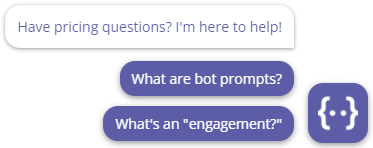

# Bot Prompts

Bot Prompts are the first messages users see that "prompt" users to engage with your bot. Bot Prompts are a call to action, ideally within the **context** of the current page the bot is on.

For example, a page for Pricing might have a different call to action than a page for Support.

Botcopy offers different types of prompts and settings to better suit the needs of a variety of use cases. Your bot can also show Bot Prompts in each language it supports. See [Multilingual Bot Prompts](/basics/bot-prompts?id=multilingual-bot-prompts).

## Intent Prompts

**Intent Prompts** are the default prompt type. Intent Prompts query Dialogflow with a **Trigger**, which is the Training Phrase or Event Name of an intent you've created on your Dialogflow agent.

The trigger will only fire on the specified **Page URL**, creating a contextualized call to action to your users.

## Preset Prompts

**Preset Prompts** differ in that they do not send a query to Dialogflow. Instead, you provide a **Message** and optional **Suggestions** and **Output Contexts**. Preset Prompts are best for high-traffic websites and can save considerable overhead with Dialogflow.

The message is rendered on the provided **Page URL**, but a query is not sent to Dialogflow until your user engages with the bot by typing a message or selecting a suggestion.

Each suggestion has a **Label** and **Trigger**. The trigger is similarly linked to a Training Phrase or Event Name.

## Default Prompt and Behavior

The **Default Prompt** is your fallback prompt. It displays on any pages not set up with a prompt.

Every language your bot supports has its own Default Prompt. When you add a language to your bot, Botcopy creates a Default Prompt for it automatically. Its trigger is a greeting in that language, such as "Hola" for Spanish or "Ciao" for Italian. You can't delete the Default Prompt for any language.

?> **Note:** Make sure your Dialogflow agent has an intent that matches this greeting in the new language, or edit the Default Prompt to use a trigger you've already set up.

You may decide you don't want the default prompt to display on pages without prompts. In that case, you can configure it so the Greeter shows without a prompt bubble.

## Prompt Settings

Each prompt has a number of settings that may also be configured. To open a prompt's settings, click its row in the Bot Prompts table.

- **Language** is the language the prompt belongs to. See [Multilingual Bot Prompts](/basics/bot-prompts?id=multilingual-bot-prompts).
- **Fullscreen Mode** enables a full screen experience for that prompt only.
- **Devices** allow you to choose which prompts show on which devices. You may choose a prompt to only show on Mobile, for example. This configuration is also available for individual preset prompt suggestions.

## Multilingual Bot Prompts

Your bot can show Bot Prompts in each language it supports, so a user's first message from the bot is in their own language. Each language has its own set of prompts and its own [Default Prompt](/basics/bot-prompts?id=default-prompt-and-behavior).

### How the Chat Window Picks a Language

When the chat window first loads, before the user has chosen a language, Botcopy picks one in this order:

1. **Forced Start Language.** If you set one, the chat window always starts in it, whatever the user's browser language is.
2. **Browser language.** If the user's browser language is one of your bot's selected languages, the chat window uses it.
3. **Default Language.** If neither applies, the chat window uses your Default Language.

The chosen language controls which prompts appear, which language is sent to Dialogflow, and the language of all chat window text. Your bot only shows languages you've selected.

If you turn on the **Language Selection** menu, users can switch languages from the chat window, and the prompts switch with them.

### Configure Your Bot's Languages

Open your bot's [Language Selection](/basics/connect?id=language-selection) settings on the Connect page:

- **Languages:** Check every language your bot should support. This list is complete: your bot won't show any language that isn't checked.
- **Default Language** (required): The fallback when a user's browser language isn't on your list. New bots start with English.
- **Forced Start Language** (optional): Empty by default. Set it if the chat window must always start in one language, for example for compliance, even when other languages are available. Users can still switch languages from the menu if it's turned on.
- **Language Selection menu:** Shows a language menu in the chat window so users can pick their language.

?> **Note:** Your Dialogflow agent must support a language for the bot's replies to appear in that language.

### Manage Prompts by Language

The Bot Prompts table lists one language at a time. Use the language filter at the top to switch languages: pick a language in the **Filter Prompts by Language** menu, then click **Filter Prompts**.

- **Create a prompt:** Choose the language first, then click **Create prompt**. The new prompt belongs to that language.
- **Edit a prompt:** Click a row in the table to open its details page.
- **Delete a prompt:** Delete prompts from the table. You can't delete the Default Prompt for any language.

### Prompts Created Before Multilingual Support

Prompts made before this feature was turned on don't have a language. They work in every language: Botcopy uses them as a fallback whenever a page has no prompt for the current language. Every prompt you create now belongs to one language. For full control, replace older prompts with one prompt per language.

### Bots That Already Used Language Selection

So that nothing changes unexpectedly, bots that already had Language Selection turned on get their current default language set as their Forced Start Language. These bots keep starting in the same language as before. If you want the user's browser language to decide instead, clear the Forced Start Language.

### Custom Language Selection Message

When Language Selection is on, users see a message telling them the bot supports other languages. The default text is "This bot supports multiple languages." You can replace it with your own message in each language. This is in early access, so contact [Botcopy support](mailto:support@botcopy.com) to turn it on.

### Troubleshooting

- **The bot starts in the wrong language:** Check whether a Forced Start Language is set. If it isn't, check that the user's browser language is on your list. If it's not, the Default Language is used.
- **The expected prompt doesn't appear:** Check that the prompt exists in the current language and targets the right Page URL. If it doesn't, an older prompt without a language or the Default Prompt for that language appears instead.
- **Prompts are in one language, but replies are in another:** Check that your Dialogflow agent supports that language and has intents for its triggers.
